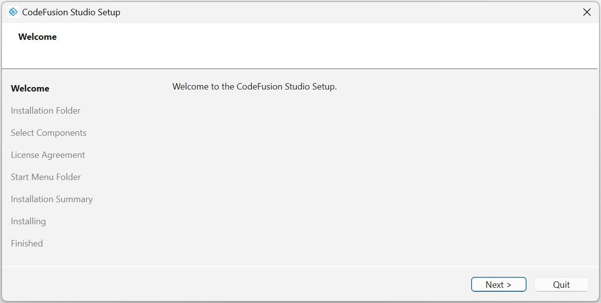
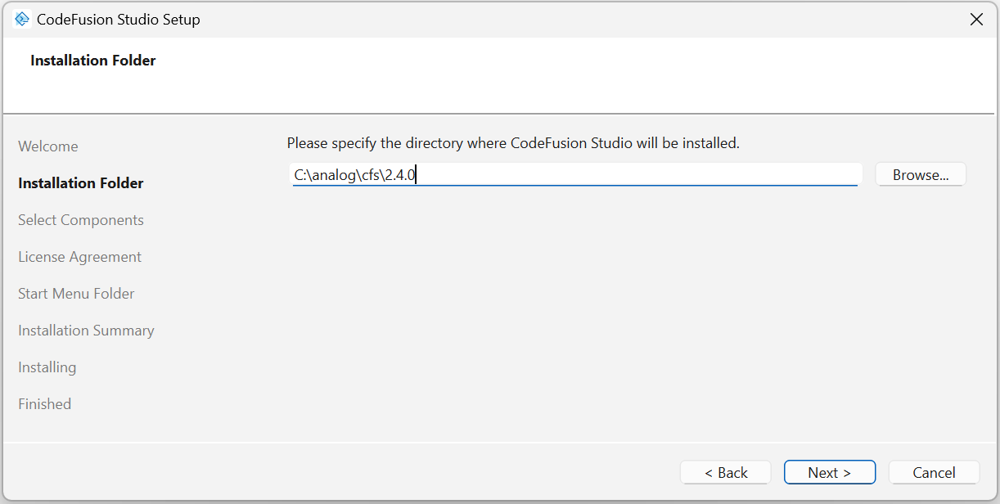
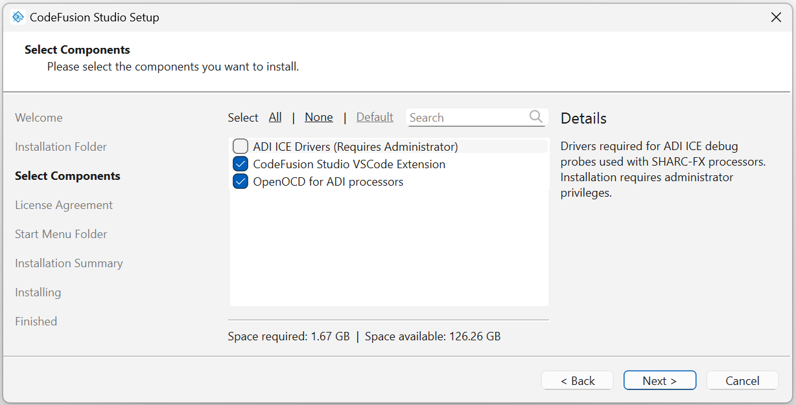
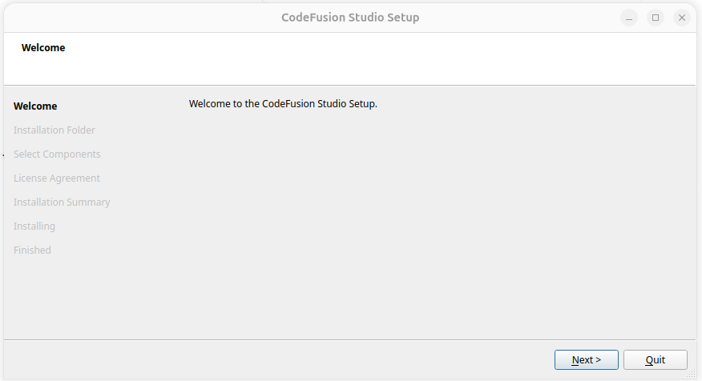
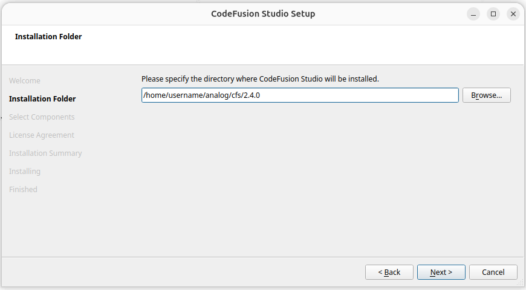
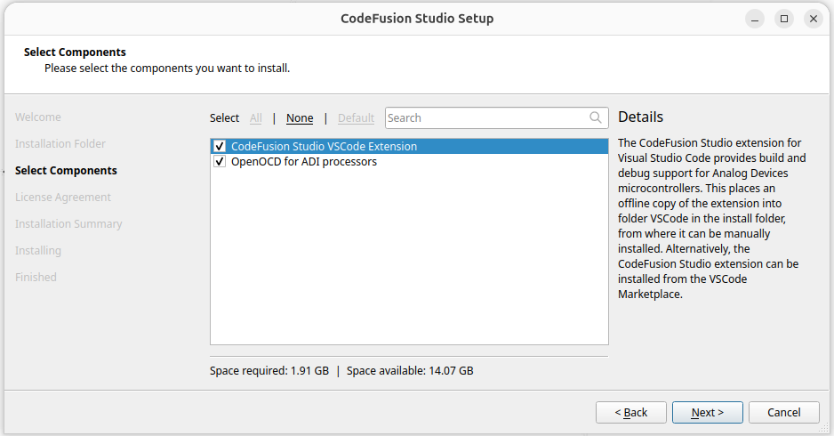
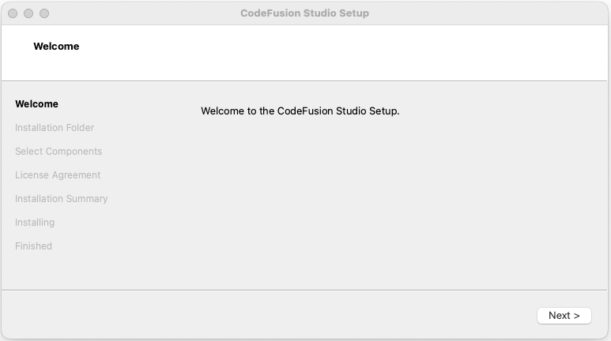
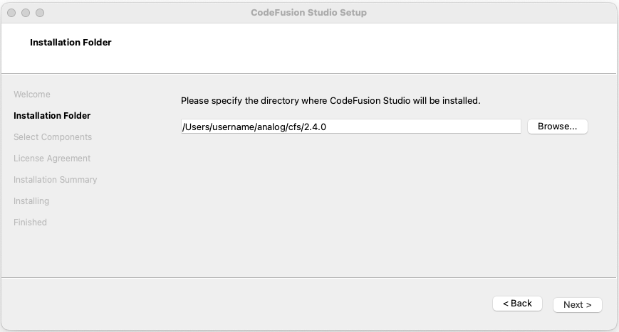
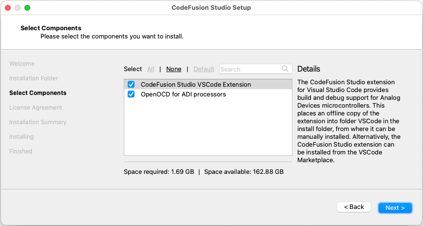

# Install CodeFusion Studio

Before you install CodeFusion Studio (CFS), select the option that applies to you.

=== "New installation"

    No additional preparation is required. Continue to [Install the CFS SDK](#install-the-cfs-sdk).

=== "Upgrade existing CFS"

    Before installing the new SDK, [uninstall the previous version and fully reset the CFS package state](../uninstall/uninstall-cfs.md). This reset removes all installed packages, cached data, and custom remotes. Then continue to [Install the CFS SDK](#install-the-cfs-sdk).

## Install the CFS SDK

### Download

Download the CodeFusion Studio installer (version 2.4.0) for your operating system:

- [:octicons-link-external-24: Windows](https://download.analog.com/codefusion-studio/2.4.0/CodeFusionStudio_2.4.0.exe){:target="_blank"}
- [:octicons-link-external-24: Linux](https://download.analog.com/codefusion-studio/2.4.0/CodeFusionStudio_2.4.0.run){:target="_blank"}
- [:octicons-link-external-24: macOS](https://download.analog.com/codefusion-studio/2.4.0/CodeFusionStudio_2.4.0.dmg){:target="_blank"}

### Option 1: Install using the setup wizard

=== "Windows"

    1. Double-click the downloaded `.exe` file to open the setup wizard, and approve the administrator prompt when it appears.

        

    2. Specify the installation folder when prompted. We recommend the default location.

        

        !!! warning
            The installation path cannot contain spaces.

    3. The installer includes three components:

        - **CodeFusion Studio VS Code Extension** (selected by default) — copies the VSIX file to your system. After the setup wizard finishes, [install the extension in VS Code](install-extensions.md) from the copied VSIX or the VS Code Marketplace.
        - **OpenOCD for ADI processors** (selected by default)
        - **ADI ICE Drivers** — select this if you plan to debug SHARC-FX processors, or [install them later](../debugging/debug-drivers/install-ice-drivers.md).

        Select the components you want to install, then select **Next**.

        

    4. Review and accept the license agreement.

    5. Select the Start Menu folder for the shortcut.

    6. Review your selections and click **Install** to start the installation. When the installation is complete, click **Finish**.

=== "Linux"

    1. Grant the downloaded installer execute permissions from a terminal:

        ``` bash
        chmod a+x CodeFusionStudio_2.4.0.run
        ```

    2. Install the packages that the installer requires to run:

        ``` bash
        sudo apt install libfontconfig1 libdbus-1-3 libxcb-cursor0 libxcb-icccm4 libxcb-image0 libxcb-keysyms1 libxcb-randr0 libxcb-render-util0 libxcb-shape0 libxcb-xinerama0 libxkbcommon-x11-0 libgl1
        ```

    3. Run the installer from the terminal to open the setup wizard:

        ``` bash
        ./CodeFusionStudio_2.4.0.run
        ```

        

        !!! note
            The installer doesn't require `sudo` to run. Running it with `sudo` additionally configures USB permissions for ICE emulators automatically — see [Install ICE drivers](../debugging/debug-drivers/install-ice-drivers.md).

    4. Specify the installation folder when prompted. We recommend the default location.

        

        !!! warning
            The installation path cannot contain spaces.

    5. The installer includes two components, both selected by default:

        - **CodeFusion Studio VS Code Extension** — copies the VSIX file to your system. After the setup wizard finishes, [install the extension in VS Code](install-extensions.md) from the copied VSIX or the VS Code Marketplace.
        - **OpenOCD for ADI processors**

        Select the components you want to install, then select **Next**.

        

    6. Review and accept the license agreement.

    7. Review selections and click **Install** to start the installation. When the installation is complete, click **Finish** to close the wizard.

=== "macOS"

    1. Double-click the downloaded `.dmg` file, then run the installer app inside to open the setup wizard.

        

    2. Specify the installation folder when prompted. We recommend the default location.

        

        !!! warning
            The installation path cannot contain spaces.

    3. The installer includes two components, both selected by default:

        - **CodeFusion Studio VS Code Extension** — copies the VSIX file to your system. After the setup wizard finishes, [install the extension in VS Code](install-extensions.md) from the copied VSIX or the VS Code Marketplace.
        - **OpenOCD for ADI processors**

        Select the components you want to install, then select **Next**.

        

    4. Review and accept the license agreement.

    5. Review your selections and click **Install** to start the installation. When the installation is complete, click **Finish** to close the wizard.

### Option 2: Install using the command line

Invoke the installer with the `install` switch to install the full package to the default location, with the following switches:

| Switch   | Effect                         |
| -------- | ------------------------------ |
| `--al`   | Accept license                 |
| `--am`   | Accept messages                |
| `-c`     | Confirms prompts               |
| `--help` | Provide help output            |
| `-t`     | Specify the path to install to |

!!! note
    When using the `--al` switch, review the [:octicons-link-external-24: CodeFusion Studio license and third-party notices](https://download.analog.com/codefusion-studio/versions.html){:target="_blank"} for the version before running the command that agrees to the terms. The same license texts are installed in the `Licenses` directory of your installation.

To run the installer from the command line, use the following:

=== "Windows"

    Run the command from an elevated command prompt (right-click **Command Prompt** and select **Run as administrator**).

    ``` bash
    CodeFusionStudio_2.4.0.exe install --am --al -c
    ```

=== "Linux"

    Running the installer with `sudo` also configures USB permissions for ICE emulators automatically — see [Install ICE drivers](../debugging/debug-drivers/install-ice-drivers.md).

    ``` bash
    sudo apt install libfontconfig1 libdbus-1-3 libxcb-cursor0 libxcb-icccm4 libxcb-image0 libxcb-keysyms1 libxcb-randr0 libxcb-render-util0 libxcb-shape0 libxcb-xinerama0 libxkbcommon-x11-0 libgl1
    chmod a+x CodeFusionStudio_2.4.0.run
    ./CodeFusionStudio_2.4.0.run install --am --al -c
    ```

=== "macOS"

    ``` bash
    hdiutil mount CodeFusionStudio_2.4.0.dmg -mountpoint cfs
    cfs/CodeFusionStudio_2.4.0.app/Contents/MacOS/CodeFusionStudio_2.4.0 install --am --al -c
    hdiutil unmount cfs
    ```

## Next steps

Next, [install the CodeFusion Studio VS Code extension](install-extensions.md).
