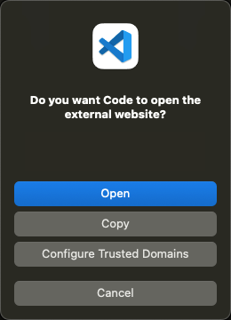
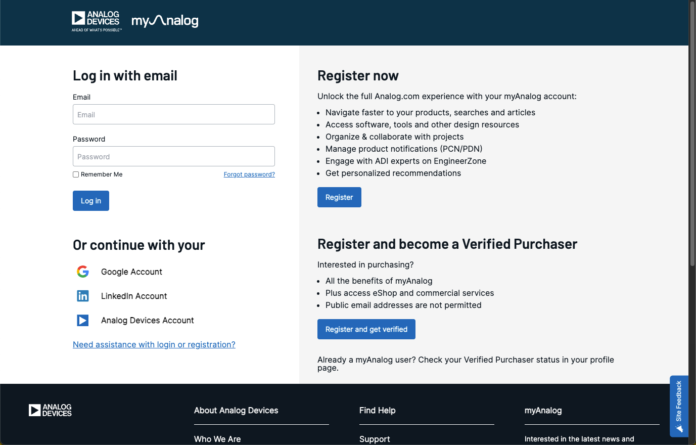

# Access restricted packages (using myAnalog login)

Some components in CodeFusion Studio are distributed as restricted packages. These packages are available through managed package remotes, and may require you to authenticate with your myAnalog account before they can be installed.

After you log in, CodeFusion Studio configures the managed remotes automatically.

!!! note
    If you use `cfsutil` for automation or CI/CD workflows, you can authenticate using an API key instead of an interactive myAnalog login. Set the `CFS_API_KEY` environment variable to your key value before running a command. See [API key authentication](../../cfsutil/apikey-auth.md) for details.

!!! note
    Access to some packages is restricted to authorized users. If you believe you should have access but cannot see the required packages, contact your account representative.

## Login to myAnalog

Before you access restricted packages, you must first log in to myAnalog.

!!! tip
    If you've logged in before, you can check your login status with:

    - **Command Palette:** `(CFS) myAnalog Status`
    - **CLI:** `cfsutil myanalog status`

### Option 1: From the Command Palette

1. Open the **Command Palette** from the **Manage** gear icon or using the keyboard shortcut (`Ctrl+Shift+P` or `Cmd+Shift+P` on macOS).
    
    
2. Type `(CFS) myAnalog Login` and press Enter, or select it from the list.
    
    
3. Click **Open** to launch the browser. If the browser does not open, use the **Copy** button to copy the link and paste it in your browser.

    

4. On the myAnalog login page, use the sign-in method associated with your account:

    - **Email and password:** Enter your registered email address and password, then select **Log in**. If you don’t have a myAnalog account, [:octicons-link-external-24: register at analog.com/myAnalog](https://www.analog.com/myAnalog){:target="_blank"}.
    - **Google Account:** Select **Google Account**, then sign in with your Google credentials.
    - **LinkedIn Account:** Select **LinkedIn Account**, then sign in with your LinkedIn credentials.
    - **Analog Devices Account:** If you are an Analog Devices employee or contractor on a managed device, select **Analog Devices Account**, then sign in with your Analog Devices credentials.

    

5. When the **Sign-in Successful** page appears, close the browser and return to VS Code.

6. A VS Code notification confirms you are logged in.

    
    

### Option 2: From the command line `cfsutil`

To access `cfsutil`, open a new terminal (**View > Terminal** or ``Ctrl+` ``).

!!! note
    If you want to run `cfsutil` from a system terminal outside VS Code, refer to the note in the **Optional: add a custom package remote** section below for the executable path to use on your platform.

Complete the following steps:

1. In the terminal panel, click the dropdown arrow next to the **+** icon.
2. Select **CFS Terminal** from the list.
    
    
3. Authenticate using your myAnalog account. A browser opens automatically.

    ```bash
    cfsutil myanalog login
    ```

4. On the myAnalog login page, use the sign-in method associated with your account:

    - **Email and password:** Enter your registered email address and password, then select **Log in**. If you don’t have a myAnalog account, [:octicons-link-external-24: register at analog.com/myAnalog](https://www.analog.com/myAnalog){:target="_blank"}.
    - **Google Account:** Select **Google Account**, then sign in with your Google credentials.
    - **LinkedIn Account:** Select **LinkedIn Account**, then sign in with your LinkedIn credentials.
    - **Analog Devices Account:** If you are an Analog Devices employee or contractor on a managed device, select **Analog Devices Account**, then sign in with your Analog Devices credentials.

    If the browser does not open, copy the authentication link from the terminal and paste it into your browser manually.

5. When the **Sign-in Successful** page appears, close the browser and return to VS Code.

!!! important
    For session-expiration and reauthentication guidance, see [Restricted packages not appearing](troubleshooting-package-manager.md#restricted-packages-not-appearing).

## Optional: add a custom package remote

You only need this section if your organization provides an additional custom package server.

### Option 1: Add a custom remote from the Command Palette

1. Open the **Command Palette** from the **Manage** gear icon or use the keyboard shortcut (`Ctrl+Shift+P` or `Cmd+Shift+P` on macOS).
    
    
2. Type `(CFS) Add Custom Package Remote` and press Enter, or select it from the list.
    
    
3. Enter the remote name and URL.
4. Select the authentication method for that custom remote.

    
    

    !!! important
        To cancel or restart this process, press **Escape**.

### Option 2: Add a custom remote from the command line `cfsutil`

1. In the terminal panel, click the dropdown arrow next to the **+** icon.
2. Select **CFS Terminal** from the list.
    
    
3. Run the following command to add the custom remote:

    ```bash
    cfsutil pkg add-remote <remote-name> <url>
    ```

    !!! example
        ```sh
        cfsutil pkg add-remote myserver https://my.server.url
        ```

4. Configure authentication for the custom remote:

    ```bash
    cfsutil pkg auth-remote <remote-name> --user <username>
    ```

    !!! example
        ```sh
        cfsutil pkg auth-remote myserver --user USERNAME
        ```

       You will be prompted to enter the password.

    !!! note
        To use no authentication for a custom remote, run `cfsutil pkg auth-remote <remote-name> --none`.

!!! note
    To run `cfsutil` from a system terminal outside VS Code, run the following executable:

    - **Windows:** `<CFS-Install>/Utils/cfsutil/bin/cfsutil.cmd`.
    - **Linux/macOS:** `<CFS-Install>/Utils/cfsutil/bin/cfsutil`.

!!! important
    Your myAnalog login session may expire after a period of inactivity. If this happens, you will need to reauthenticate to access restricted packages. For more details, see [Restricted packages not appearing](troubleshooting-package-manager.md#restricted-packages-not-appearing).

## Verify your setup

After login, verify that managed remotes are configured correctly.

Run the following command in the **CFS Terminal**:

```bash
cfsutil pkg list-remotes
```

## Next steps

Now that you are logged in, you can proceed to install packages in CodeFusion Studio.
Choose your preferred method below:

- To install packages from the Command Palette, see [Manage packages from VS Code Command Palette](manage-packages-command-palette.md).
- To install packages using the command line, see [Manage packages from the command line (`cfsutil`)](manage-packages-cfsutil.md).
