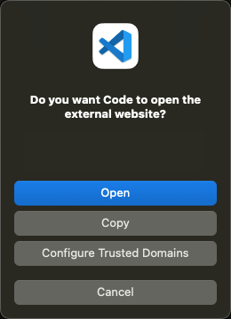
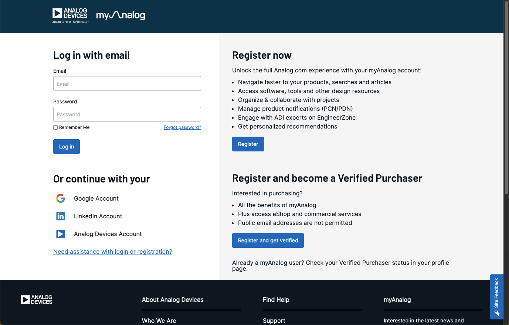

# Manage packages from the Package Manager UI

The Package Manager UI lets you browse, filter, and install packages directly in VS Code without using the Command Palette or command line. You can view package details, select versions, review licenses, uninstall packages, and manage package remotes — all from a single panel.

## Open the Package Manager

To open the Package Manager UI:

1. Click the CodeFusion Studio icon   in the VS Code activity bar.
2. Click **Manage Packages** in the **Home** section.

    
    

!!! tip
    You can also open the Package Manager from the Command Palette (`Ctrl+Shift+P` / `Cmd+Shift+P`) by running **(CFS) Open Package Manager**.

## Sign in to access restricted packages

Some packages require a myAnalog account. When the Package Manager opens, a sign-in prompt appears at the top of the panel if you are not already logged in. You can dismiss the prompt and browse public packages without signing in.

To sign in:

1. Select **Sign In**. A browser prompt appears in VS Code.
2. Select **Open** to open the browser. If the browser does not open, select **Copy** to copy the link and paste it into your browser manually.

    

3. On the myAnalog login page, use the sign-in method associated with your account:

    - **Email and password:** Enter your registered email address and password, then select **Log in**. If you don’t have a myAnalog account, [:octicons-link-external-24: register at analog.com/myAnalog](https://www.analog.com/myAnalog){:target="_blank"}.
    - **Google Account:** Select **Google Account**, then sign in with your Google credentials.
    - **LinkedIn Account:** Select **LinkedIn Account**, then sign in with your LinkedIn credentials.
    - **Analog Devices Account:** If you are an Analog Devices employee or contractor on a managed device, select **Analog Devices Account**, then sign in with your Analog Devices credentials.

    

4. When the **Sign-in Successful** page appears, close the browser and return to VS Code.
5. A VS Code notification confirms you are logged in.

    
    

!!! tip
    To check your login status at any time, run **(CFS) myAnalog Status** from the Command Palette. For session expiry and reauthentication guidance, see [Access restricted packages](auth.md).

## Browse and filter packages

The Package Manager displays all available packages in a paginated list. Use the search bar and filters to find what you need.

### Search

Enter a package name, SoC, or description in the search bar to filter packages. The total number of matching packages updates as you type.

### Filters

The following filters are available:

| Filter | Options |
|---|---|
| **Required** | Show only packages required by the current workspace, as declared in its `.cfsdependencies` manifests |
| **Status** | Installed, Not Installed, Update Available |
| **SoC** | Filter by supported processor |
| **Type** | Data Model, Plugin, SDK, Toolchain |

Select multiple options within a filter to broaden results. Combine filters to narrow the list.

The **Required** filter combines requirements from every `.cfsdependencies` manifest in the open workspace, including nested directories but excluding `node_modules` and `.git`. The standard workspace manifest is in the `.cfs` directory, for example: `C:\Users\<username>\cfs\2.4.0\my-sample-workspace\.cfs\.cfsdependencies`. The manifest also drives the notification that appears when you open a workspace with missing packages, which offers to install them. For the manifest format, see [Manifest files](../../cfsutil/package-manager.md#manifest-files).

### Select All

Use the **Select All** checkbox to select all packages on the current page.

## View package details

Select the expand arrow on a package card to view details:

- **Description** — what the package provides
- **Type** — Data Model, Plugin, SDK, or Toolchain
- **CFS compatibility** — which CFS versions this package supports
- **License** — the license name with a **View License** link
- **Cached versions** — versions already downloaded locally
- **Supported SoCs** — processors this package targets

## Select a version

Each package card includes a version menu. The installed version and latest version are labeled in the list. Select a different version before installing if needed.

If a workspace requires a specific version range, the required range appears beneath the version menu. Selecting a version outside the required range shows a warning.

## Install packages

1. Check the box on one or more package cards to select them.
2. Select **Continue**.
3. A review summary lists all selected packages and their versions. Any dependencies required by the selected packages are resolved and shown automatically. Review the details, then select **Continue**.

    
    

    If the packages you selected pull in incompatible versions of the same package — whether that package is one of your direct selections or a dependency they share — the review summary screen reports the conflict and **Continue** is unavailable until you resolve it. For steps, see [Dependency conflicts between selected packages](./troubleshooting-package-manager.md#dependency-conflicts-between-selected-packages).

4. The license review screen appears. Review each license — a checkmark indicates you have opened it. The **Accept License(s) and Install** button becomes active once all licenses have been reviewed. Select **Accept License(s) and Install** to proceed.

    
    

5. Installation begins. A progress indicator appears during installation.

!!! note
    Built-in packages ship with CFS and cannot be uninstalled. They are indicated by a tool icon () rather than a delete icon.

## Check for package updates

CodeFusion Studio checks for newer versions of the installed packages listed in your workspace `.cfsdependencies` files when you open the workspace. If updates are available, a notification lists the packages.

1. Select **Open Package Manager**.
2. From the **Status** filter, select **Update Available** to list the packages with newer versions.
3. [Install the new versions](#install-packages), including reviewing any licenses.

!!! tip
    To check for updates manually or turn off the automatic check, see [Check for package updates](manage-packages-command-palette.md#check-for-package-updates).

## Uninstall packages

1. Select the delete icon to the right of the package card (installed packages only).
2. If the package has dependent packages that will also be removed, a confirmation modal lists them.
3. Select **Uninstall** (or **Yes, Uninstall All** when dependent packages are listed) to confirm, or **Cancel** to exit without changes.

Select **Don't show this message again** in the confirmation modal to skip the confirmation dialog for future uninstalls where the package has no dependents. The confirmation dialog always appears when dependent packages will also be removed.

!!! tip
    To remove cached packages after uninstalling, use the **(CFS) Delete Package from Cache** command in the Command Palette. See [Manage packages from the Command Palette](manage-packages-command-palette.md#delete-a-package-from-cache).

## Manage package remotes

Use the **Remotes** tab to manage the package remotes that the Package Manager gets packages from. Select **Remotes** in the Package Manager.

The tab lists every remote, both managed and custom. Each remote card shows the remote name, its URL, and a switch to turn the remote on or off. Cards also show the authentication method (**No Auth**, **myAnalog**, or **Username / Password**), except for disabled custom remotes. Custom remotes also show a **Custom** badge, a **Configure authentication** action, and a **Delete** action.

After you sign in to myAnalog, CodeFusion Studio configures the managed remotes automatically. You only need to add a custom remote if your organization provides an additional package server, for example a private repository for packages you develop in-house.

### Add a custom remote

1. Select **Add remote**.
2. In the Add Custom Remote panel, enter a **Remote name**. Use only letters, numbers, hyphens, and underscores. The name must be unique.
3. Enter the **Remote URL**. The URL must start with `http` or `https`.
4. Under Authentication, select **No Authentication** or **Username / Password**. If you select Username / Password, enter the **Username** and **Password**.
5. Select **Add Remote**.

If you enter credentials, CodeFusion Studio logs in to the remote immediately.

!!! note
    You can't change the name or URL of a remote after you add it. To use a different name or URL, delete the remote and add it again.

### Enable or disable a remote

Turn the remote on or off using the switch on its card. CodeFusion Studio doesn't use a disabled remote to find or install packages. While the change is in progress, the switch tooltip shows **Updating...**, and only that remote card is locked until the change finishes.

### Change the authentication of a custom remote

1. On the custom remote card, select **Configure authentication**.

    !!! note
        **Configure authentication** is unavailable while the remote is disabled. Enable the remote first.

2. In the Edit Custom Remote panel, select **No Authentication** or **Username / Password**, and update the credentials.
3. Select **Save**.

To keep the stored password, leave the **Password** field empty. This works only if you don't change the username. If you change the username, enter the password again.

### Delete a custom remote

1. On the custom remote card, select **Delete**.
2. In the confirmation dialog, select **Remove** to confirm, or **Cancel** to exit without changes.

Removing a remote is permanent. The remote is no longer available as a package source.

!!! tip
    If you add, delete, enable, or disable a remote outside the Package Manager, for example [from the command line](auth.md#option-2-add-a-custom-remote-from-the-command-line-cfsutil) or [from the Command Palette](auth.md#option-1-add-a-custom-remote-from-the-command-palette), the **Remotes** tab updates automatically.
