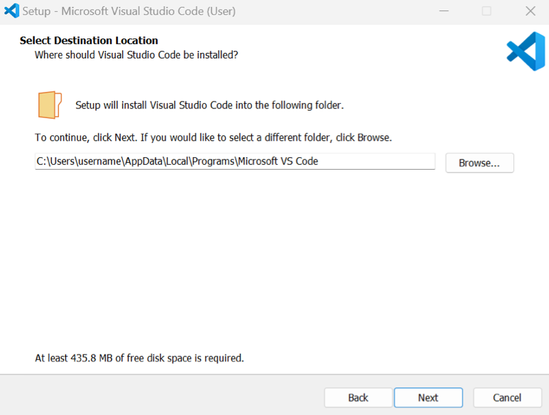
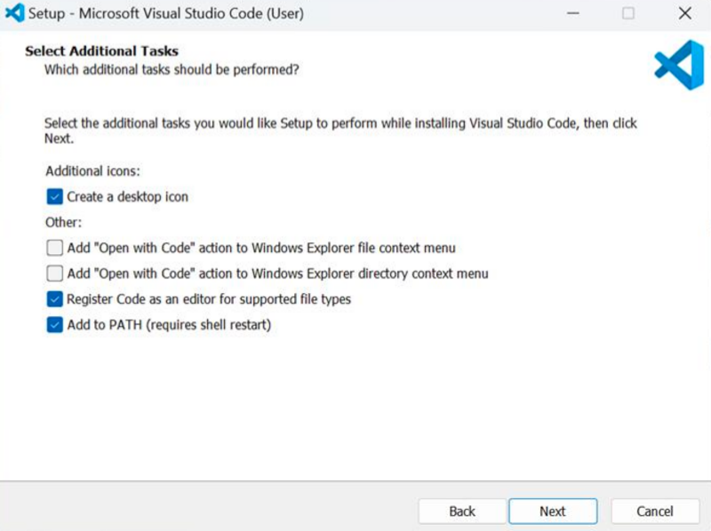

# Software requirements

## Host OS support

CodeFusion Studio and its extension are supported on the following host operating systems:

- Windows 11 (64-bit)
- macOS 15 and macOS 26 (ARM64)
- Ubuntu 22.04 and 24.04 (x86-64)

*Earlier or newer OS versions may work but are not officially supported.*

## Software dependencies

The CodeFusion Studio VS Code extension depends on [:octicons-link-external-24: Microsoft Visual Studio Code](https://code.visualstudio.com/){:target="_blank"} version **1.101** or later (recommended).

!!! note
    Older versions of VS Code (such as 1.98 and earlier) are not supported due to known layout issues in the **System Planner > Pin Config** canvas.

## Install Visual Studio Code

=== "Windows"

    1. Download the installer from the [:octicons-link-external-24: Visual Studio Code download page](https://code.visualstudio.com/download){:target="_blank"}.

    2. Run the installer and accept the license agreement.

    3. When prompted, select the installation folder. We recommend the default location.

        

    4. Follow the on-screen prompts, keeping the default settings, including the defaults on the **Select Additional Tasks** page.

        

    5. Select **Install**.

    6. Open Visual Studio Code to verify that it opens correctly.

=== "Linux"

    1. Download the **x64** `.deb` package from the [:octicons-link-external-24: Visual Studio Code download page](https://code.visualstudio.com/download){:target="_blank"}.

    2. Install the downloaded package from a terminal:

        ``` bash
        sudo apt install ./code_<version>_amd64.deb
        ```

        Replace `code_<version>_amd64.deb` with the name of the downloaded file. When asked to confirm the required disk space, enter `Y` to continue.

    3. Open Visual Studio Code from the terminal to verify that it opens correctly:

        ``` bash
        code
        ```

=== "macOS"

    1. Download the macOS (Apple silicon) build from the [:octicons-link-external-24: Visual Studio Code download page](https://code.visualstudio.com/download){:target="_blank"}.

    2. Double-click the downloaded archive to extract **Visual Studio Code.app**.

    3. Move `Visual Studio Code.app` to the `Applications` folder.

    4. Open Visual Studio Code to verify that it opens correctly.

## Next steps

After installing the required software, [install CFS](install-cfs.md).
