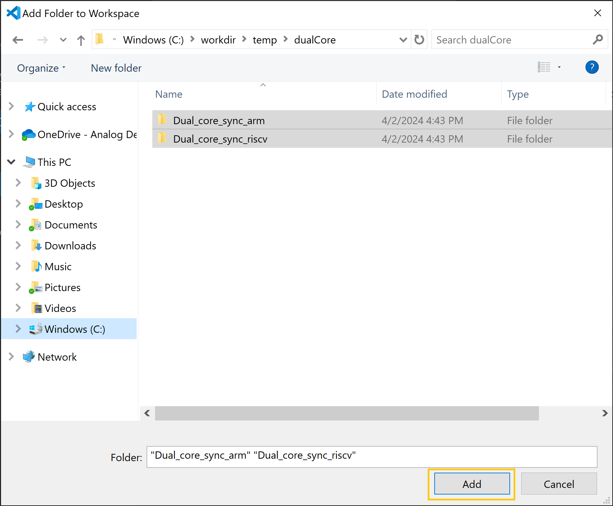

# Explore and open MSDK examples

The MSDK provides example projects for each supported microcontroller. These examples demonstrate peripheral APIs, middleware, and other libraries, serving as references and starting points for your own applications.

!!!note
    If you plan to migrate a project to System Planner, follow the steps in [migrate a project to System Planner](../workspaces/migrate-project-to-system-planner.md)

## Before you start

Install the MSDK using the [Package Manager](../installation/package-manager/index.md). CodeFusion Studio automatically locates the installed package and its examples.

## Open an example project

1. Click the CodeFusion Studio icon   in the VS Code activity bar.  
2. Click **Browse MSDK Examples**.

    
    

    !!! tip
        You can also open the **Command Palette** (`Ctrl+Shift+P` / `⇧⌘P` on macOS) and type **Browse MSDK Examples** to launch the same dialog.

3. In the dialog that appears, choose your target SoC.  
4. Browse or search for the desired example.  
5. Click **Select Example**.  
6. Choose a destination folder to create a local copy of the project.
7. A new VS Code window opens. If you receive the notification **Do you trust the authors of the files in this workspace?**, click **Yes, I trust the authors** to continue.  
8. If your existing project has not been configured as a CodeFusion Studio workspace, wait for the **Configuring** dialog box to complete before proceeding.

## Open multiple examples together (optional)

You can open multiple example projects in a single workspace—for example, to compare code or build and run multi-core projects.

### Duplicate the example folder

!!! warning
    We strongly recommend copying the example projects before modifying any files to preserve the original examples.

1. Open **File Explorer**.  
2. Examples are located in the Package Manager package directory. Select **Browse MSDK Examples** to determine the correct location.
    - **Linux:** `/home/<username>/.local/share/com.analog.cfs/packages/conan/p/msdk<id>/p/Examples`  
    - **macOS:** `/Users/<username>/Library/Preferences/com.analog.cfs/packages/conan/p/msdk<id>/p/Examples`
    - **Windows:** `C:\Users\<username>\AppData\Local\com.analog.cfs\Data\packages\conan\p\msdk<id>\p\Examples`  
3. Copy the **Examples** folder to a writable location.

### Open the examples in VS Code

1. Launch **VS Code**.  
2. Click the **Explorer** icon in the activity bar.  
3. Click **Open Folder**.  

    
    

    !!! tip
        You can also select **File > Open Folder** from the top menu.

4. Navigate to the location where you saved the examples.
5. Select two example projects to open.

    

    !!! warning
        You must select two distinct projects, each containing a **makefile** at the highest level in their respective folder structure.

6. If prompted with **Do you trust the authors of the files in this workspace?**, click **Yes, I trust the authors**.  
7. If your existing project has not been configured as a CodeFusion Studio workspace, wait for the **Configuring** dialog box to complete before proceeding.
8. Confirm the projects are ready by expanding each `.vscode` folder and verifying that `settings.json` contains valid project settings.  

    
    
