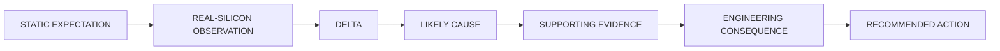

# CFS AI Engineering Report

Take an evidence bundle produced by `cfs-ai-evaluation` and do the engineering
reasoning: correlate static expectation with real-silicon observation, explain the
deltas, name the bottleneck, and recommend what to try next.

This skill **interprets facts**. It does not establish them. It never builds, flashes,
runs or captures anything — if the evidence you need is missing, say so and name the
`cfs-ai-evaluation` run that would produce it.

## 1. Preconditions

The required input is a `manifest.json` from an evaluation evidence directory.
When continuing from `cfs-ai-evaluation`, use the bundle offered in that conversation:
"yes", "continue", or "analyze the results" accepts the report offer. The user does
not need to invoke this skill by name, confirm again, or repeat the model and target.
If more than one bundle could be intended, clarify which one before analyzing.

Carry forward any user-stated question, performance budget, constraints or analysis
focus and address them in the findings and recommendations. These are user goals,
not measured facts; do not invent a budget when none was supplied.

The evaluation evidence is in the manifest and the `.cfsreport` files it points at.
**Do not rediscover
the setup** — do not search the repository, re-read CFS documentation, re-parse the
raw trace, or re-run any analysis script. If a number is not in the bundle, it was not
measured, and that is itself a finding.

Read, in this order:

1. `manifest.json` — `execution`, `inputs`, `static`, `build`, `runtime`,
   `correlation`, `caveats`, `timing`.
2. `reports.runtime` — only when non-null and you need per-layer invocation detail
   beyond `correlation.per_layer`. Text smoke bundles may omit this file.
3. `resource.cfsreport` — only if you need static per-layer fields the correlation
   omits (`memory_kb`, `energy_uj`, optimization opportunities).
4. `../cfs-ai-evaluation/references/known-issues.md` (in the `cfs-ai-evaluation`
   skill) — to explain a `caveats[]` flag.

Do **not** load `run.tef` into context. It is hundreds of kilobytes and everything
derivable from it is already aggregated.

Check first, and stop if violated: `execution.status` is `completed` or `completed_smoke`;
`runtime.capture_complete` is true, or the recorded `observed_inferences` and
`expected_inferences` counts are equal and positive. Missing counts do not establish
completeness.
Timing from a truncated capture must not be analysed. If `build.timing_sound` is
false the build duration is void — exclude it, do not reason about it.

For `completed_smoke`, produce a limited smoke and memory report. Complete text
evidence is sufficient even when `runtime.latency_us` and `reports.runtime` are
null because the selected template emits no timing. Report completion, arena use, linked allocations and static
estimates under their own labels. Mark timing, per-layer bottlenecks, accuracy and
user-dataset coverage unavailable with the recorded reason; skip unsupported causal
claims and latency comparisons. The demo's `passed`/`failed` labels are not model
accuracy. If `text_run_identity_unverified` is flagged for a historical capture,
state that its association with the intended flash was not established.
Do not rebuild or reflash merely to fill these gaps. Keep the scorecard shape,
using unavailable entries where needed.

## 2. Label every claim

Four categories, kept visibly distinct throughout. This is the skill's core contract:

- **MEASURED** — came off the silicon. Latency statistics, `arena_used_bytes`, operator
  rollup, linked section sizes, the ELF hash.
- **CALCULATED** — arithmetic on measured or static values. Ratios, cycles/MAC,
  percent-of-inference, reclaimable RAM. Deterministic, no judgement.
- **INFERRED** — your hypothesis about cause. Must cite the evidence supporting it and
  say what would falsify it.
- **RECOMMENDED** — an action, with its expected effect and how to verify it.

Never present an inference as a measurement. "Pointwise convolutions are 53.6% of the
inference" is MEASURED; "they are compute-bound at the selected core's MAC floor" is INFERRED
from the cycles/MAC figure and should be labelled as such.

Keep separate, and never merge: static estimates, linked firmware allocations,
measured timings, derived values. Tensor arena usage is **not** total RAM. Reciprocal
latency is **not** measured throughput — the stock workload is startup-only, so never
invert a single inference time into a rate.

## 3. The reasoning chain

For each significant finding, in order:

Work through these questions, skipping any the bundle cannot support:

**Compute.** Which operators dominate `runtime.by_operator_us`? Use the total
inference time as the denominator — `sum(by_operator_us) + unattributed_framework_us`
— not the operator sum alone. For each dominant operator, what is
`correlation.per_layer[].cycles_per_mac`? A figure near the target's documented MAC
cost means the layer is compute-bound and already near the floor, so **only reducing
MACs helps there**. A figure several times higher means the implementation, not the
arithmetic, is the cost — that is where optimization has headroom. Compare the share
of *time* against the share of *MACs*: an operator taking 30% of the time for 11% of
the MACs is the real inefficiency even when another takes 67%.

**Estimate fidelity.** `correlation.measured_vs_estimated_ratio` is the headline, but
the per-layer ratios matter more: a uniform ratio suggests a global factor (clock,
build optimization, memory latency), while a ratio that is ~1.1x on some operators and
~5x on others means the estimator's cost model fits some kernels and not others. Name
which. State the ratio; do not imply the estimate was validated.

Use **measured ÷ static estimate** consistently for latency and memory estimate
comparisons, with matching units and an explicit ratio label. Report `unavailable`
with a reason if either input is missing or the estimate is zero. The separately
named `arena_linked_over_used` ratio remains **linked ÷ used**; it measures allocation
overhead, not estimate fidelity.

**Memory.** Compare `build.arena_linked_bytes`, `static.profile.peak_memory_kb` and
`runtime.arena_used_bytes`. Report `build.ram_pct` against the part's SRAM and
`correlation.reclaimable_ram_bytes`. Say plainly whether the part is near its RAM
limit and whether that is real or an artefact of a loose arena estimate.

**Build configuration.** If `debug_build_not_speed_optimized` is flagged, part of the
gap is the build, not the silicon. Treat that as a confound on every latency
conclusion and say so.

**Data movement, accelerators, waits.** Address these only if the bundle carries
evidence (`is_accelerated`, transfer or wait events). On a CPU-only TFLM target it
usually does not. Say "not measurable from this evidence" rather than speculating.

**Architecture fit.** Given the operator mix and cycles/MAC, is the model well matched
to this core? Would a different quantization, a narrower model, or fewer channels in
the dominant layers help more than kernel-level work?

## 4. Recommend, prioritized

Lead with the single experiment with the best expected-gain-to-effort ratio. For each
recommendation give: the change, the expected effect, the evidence it rests on, and
how to verify it — normally a concrete `cfs-ai-evaluation` invocation.

Prefer a change that tests a hypothesis over one that merely tunes. Prefer one that
isolates a confound (for example, rebuilding with speed optimizations to separate
debug overhead from silicon) before one that optimizes the model, because an
unresolved confound makes every later measurement ambiguous.

Do not recommend more than three. Do not recommend anything whose expected effect you
cannot tie to a number in the bundle.

## 5. Uncertainty

State plainly what remains unknown and why, distinguishing:

- **Not instrumented** — e.g. power. A zero-filled field does not prove zero.
- **Structurally impossible from this evidence** — e.g. accuracy from a profiling
  build. Say it cannot be added to this build, not merely that it was not measured.
- **Measured but weakly** — n below 20, so percentiles were withheld; or a
  deterministic workload where repeat runs yield no spread, so the spread is not an
  uncertainty estimate.
- **Confounded** — a debug build, a host-timing caveat, an untiled single sample.

If the evidence contradicts itself, say so and do not pick a side silently.

## 6. Output

Read `references/report-template.md` for the shape and a worked example. Keep the
report dense: no greetings, no promotional text, no tool-call transcripts, no repeated
summary paragraphs. Use `unavailable` with a reason rather than omitting a field.

**Close with the scorecard.** Prose is the right medium for a causal argument and the
wrong one for eight numbers a reader wants to compare at a glance, so every report ends
with the four tables specified at the bottom of `references/report-template.md`:
headline, where the time goes, memory, and next. They are required and always last.

The tables do not replace the reasoning chain — they are the same facts indexed for
reuse, and a table is not licence to drop the MEASURED / CALCULATED / INFERRED labels.
Carry the category into the column headers and the `Verdict` column. Anything you could
not establish reads `unavailable` with a short reason; never leave a cell blank and
never fill one with a plausible-looking number the bundle does not contain.

Cite CFS documentation by **page title**, not repository path — the docs tree is not
present once this skill is installed. For doc text, defer to the `cfs-docs` skill.
